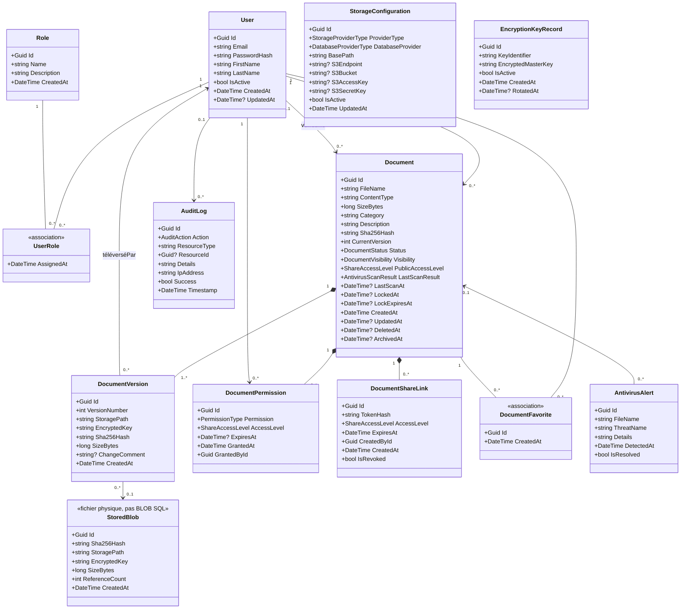

# Diagramme de classes complet — SecureFileStorage

Modèle **domaine uniquement** : chaque entité apparaît **une seule fois**, les relations sont tracées **sans doublon**.

Fichier PlantUML : [`diagramme-classes.puml`](./diagramme-classes.puml)

---

## Mode de stockage des fichiers

**Choix : stockage physique (fichier binaire chiffré sur disque), pas de BLOB SQL.**

| Élément | Rôle |
|---|---|
| Système de fichiers (`./storage`) | Contenu binaire chiffré AES-256 (`.enc`) |
| PostgreSQL | Métadonnées uniquement |
| `StoredBlob` | Référence logique (chemin, SHA-256, clé, compteur) — **pas** un type BYTEA/BLOB |
| `Document` / `DocumentVersion` | Identité métier, versions, droits |

Le fichier physique est enregistré sous `{BasePath}/blobs/{SHA-256}.enc`. Plusieurs versions peuvent partager le même `StoredBlob` (déduplication). Les fournisseurs S3 / NAS restent prévus dans `StorageConfiguration`, sans jamais placer le binaire en colonne SQL.

### Compression et déchiffrement

- **Écriture** : compression GZip (si le fichier n’est pas déjà compact) **puis** chiffrement AES-256.
- **Lecture** (téléchargement, prévisualisation, intégrité) : déchiffrement AES-256 **puis** décompression. L’utilisateur ne manipule jamais les clés (clé par fichier enveloppée par la clé maître).
- Les fichiers stockés avant l’ajout de la compression restent lisibles (marqueur `SFSZ`).

---

## Principes (anti-redondance)

| Règle | Application |
|---|---|
| 1 classe = 1 entité | Pas de DTO, pas de DbContext |
| Associations = liens UML | Pas de `ICollection<>` dans les attributs |
| FK non répétées en attribut | Les liens portent les multiplicités (`Owner`, `LockedBy`, etc.) |
| N–N avec données | `UserRole`, `DocumentFavorite` = **classes d’association** (pas une 2ᵉ table fantôme) |
| Admin inclus | `StorageConfiguration`, `EncryptionKeyRecord`, `AntivirusAlert`, `AuditLog` |

---

## Classes (13)

### Identité & RBAC
- **User** — compte
- **Role** — Admin / User
- **UserRole** — association User ↔ Role (`AssignedAt`)

### Gestion documentaire
- **Document** — agrégat central
- **DocumentVersion** — versions
- **StoredBlob** — référence au fichier physique chiffré (dédupliqué) ; pas un BLOB SQL
- **DocumentPermission** — partage utilisateur
- **DocumentShareLink** — lien temporaire
- **DocumentFavorite** — association User ↔ Document

### Audit & administration
- **AuditLog** — journal
- **AntivirusAlert** — alerte liée à un document
- **StorageConfiguration** — Local / S3 / NAS + BDD
- **EncryptionKeyRecord** — clés / rotation

---

## Relations (liens uniques)

```
User 1 ────── * UserRole * ────── 1 Role

User 1 ──possède───► * Document
User 0..1 ─verrouille► * Document

Document 1 ◆── * DocumentVersion
DocumentVersion * ──► 0..1 StoredBlob
DocumentVersion * ──► 1 User (téléverséPar)

Document 1 ◆── * DocumentPermission ◄── * User
Document 1 ◆── * DocumentShareLink

User 1 ── * DocumentFavorite * ── 1 Document

User 0..1 ──► * AuditLog
Document 0..1 ◄── * AntivirusAlert
```

---

## Énumérations (8)

| Enum | Valeurs |
|---|---|
| DocumentStatus | Active, Archived, Deleted |
| DocumentVisibility | Private, Shared, Public |
| ShareAccessLevel | Read, Download, Write, Preview |
| PermissionType | Read, Write, Delete, Admin |
| AntivirusScanResult | Clean, Infected, Skipped, Error |
| AuditAction | Upload, Download, View, Update, Delete, Archive, Restore, Search, Preview, Login, Logout, Share, CheckOut, CheckIn, Favorite, Import, PermissionChange, IntegrityCheck, AntivirusAlert |
| StorageProviderType | LocalFileSystem, S3Compatible, Nas |
| DatabaseProviderType | PostgreSql, SqlServer |

---

## Vue Mermaid (complet)



### Export image

1. Ouvre [`diagramme-classes.puml`](./diagramme-classes.puml) sur [PlantUML Online](https://www.plantuml.com/plantuml/uml)  
2. Ou extension PlantUML dans VS Code / Cursor → Export PNG/SVG
