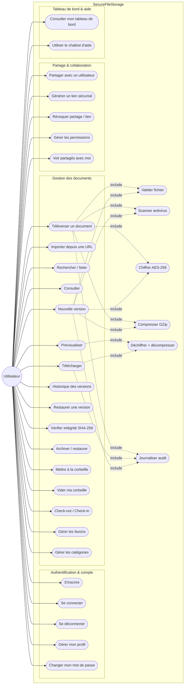
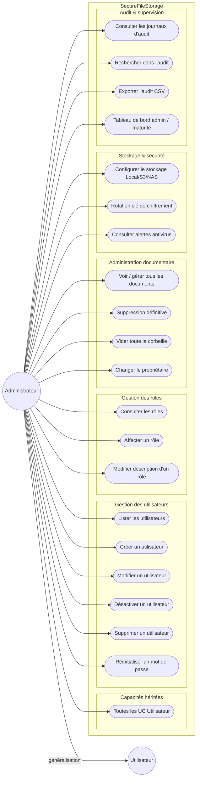

# Diagrammes de cas d’utilisation — SecureFileStorage

Système : **microservice de stockage et de lecture sécurisée des fichiers**.

Acteurs principaux : **Utilisateur** (`User`) et **Administrateur** (`Admin`).

Fichiers PlantUML associés :
- [`usecase-utilisateur.puml`](./usecase-utilisateur.puml)
- [`usecase-administrateur.puml`](./usecase-administrateur.puml)

---

## 1. Diagramme — Utilisateur



### Liste des cas d’utilisation Utilisateur

| Package | Cas d’utilisation |
|---|---|
| Authentification | S’inscrire, Se connecter, Se déconnecter, Gérer mon profil, Changer mon mot de passe |
| Documents | Téléverser, Importer URL, Rechercher, Consulter, Prévisualiser, Télécharger, Versionner, Historique, Restaurer version, Vérifier intégrité, Archiver, Corbeille, Check-out/in, Favoris, Catégories |
| Partage | Partager (utilisateur), Lien sécurisé, Révoquer, Permissions, Partagés avec moi |
| Aide | Tableau de bord, Chatbot |

**Relations `<<include>>`** : téléversement / nouvelle version = validation → antivirus → compression GZip → chiffrement AES-256 → audit. Téléchargement / prévisualisation = déchiffrement + décompression.

---

## 2. Diagramme — Administrateur



### Liste des cas d’utilisation Administrateur

| Package | Cas d’utilisation |
|---|---|
| Héritage | Toutes les UC de l’Utilisateur |
| Utilisateurs | Lister, Créer, Modifier, Désactiver, Supprimer, Réinitialiser mot de passe |
| Rôles | Consulter, Affecter, Modifier description |
| Documents (étendue) | Voir tous les documents, Suppression définitive, Vider toute la corbeille, Changer propriétaire |
| Sécurité | Configurer stockage, Rotation clé, Alertes antivirus |
| Audit | Consulter, Rechercher, Exporter CSV, Dashboard maturité |

**Relation de généralisation** : `Administrateur` hérite de `Utilisateur` (l’admin peut tout faire qu’un user, plus l’administration).

---

## Correspondance API (rappel)

| Acteur | Endpoints |
|---|---|
| Utilisateur | `/api/auth/*`, `/api/documents/*`, `/api/share/*`, `/api/chat`, dashboard |
| Administrateur | `/api/admin/users`, `/api/admin/roles`, `/api/admin/storage`, `/api/admin/audit`, `/api/admin/security/*` |
```
